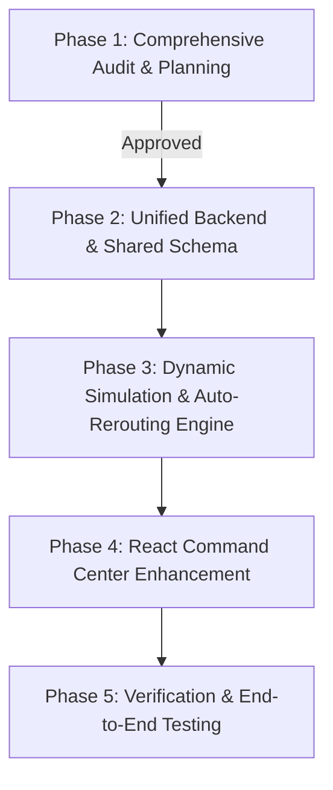

# MERGE_PLAN: Dynamic Emergency Resource Coordination

**Target Project:** Unified Autonomous Disaster Management & Dynamic Resource Coordination Command Center  
**Base Systems:**  
* System A: `ADRACS` (`/Users/vanshkumar/Autonomous-Disaster-Response-And-Coordination-System`)  
* System B: `ResQNet` (`/Users/vanshkumar/ResQNet`)  
**Workspace:** `/Users/vanshkumar/Downloads/H2`  
**Current Phase:** Phase 1 Complete (Audit & Plan Only). Awaiting explicit user approval before Phase 2.

---

## 1. Architectural Strategy & Recommendations

### 1.1 Backend Recommendation: FastAPI (from ResQNet) + ADRACS Hybrid Services
* **Why FastAPI?** Asynchronous I/O, native WebSocket / Socket.io support, background tasks, high-concurrency throughput, automatic OpenAPI/Swagger docs, and clean integration with React.
* **Resilience Enhancement:** Update [`database/db.py`](file:///Users/vanshkumar/ResQNet/backend/database/db.py) to dynamically check `DATABASE_URL`; if PostgreSQL is not detected or fails to connect, gracefully fall back to local SQLite (`sqlite:///./disaster_coord.db`). This guarantees zero friction during evaluation or local running.

### 1.2 Shared Data Model Strategy
Unify the SQLAlchemy data models into a single canonical relational schema in `backend/database/models.py`:
1. `User` (JWT auth, RBAC: `admin`, `responder`, `citizen`)
2. `Incident` (type, severity, coordinates, status, description, assigned rescue team, created_at)
3. `Sensor` (water level, seismic, temperature, wind, thresholds, status, coordinates)
4. `Alert` (threshold warnings, system notifications, broadcast status)
5. `Shelter` (capacity, occupancy, food_days, water_days, medical_level, coordinates)
6. `Resource` (type: medical, food, water, boat, vehicle; total_qty, allocated_qty, available_qty, depot_location)
7. `RescueTeam` (specialization, size, coordinates, status: Available / Dispatched / En Route, contact)
8. `EvacuationRoute` (source/dest lat/lng, distance_km, status: Safe / Congested / Blocked, hazard_info, geometry)
9. `Mission` (incident_id, title, status, assigned_team_id, plan_details)
10. `Log` (agent/service name, action, details, timestamp)

### 1.3 Frontend Strategy: React 19 + MapLibre GL Command Center (from ResQNet)
* Keep the dark-mode NASA Command Center UI from ResQNet.
* **Fix Critical UI Stubs:**
  1. Replace hardcoded "Priority Action List" in [`Dashboard.tsx`](file:///Users/vanshkumar/ResQNet/frontend/src/pages/Dashboard.tsx#L254-L275) with dynamic data streamed from `/api/priority/list`.
  2. Implement functional "Medical Units" and "Evac Shelters" views connected to live backend models (replacing the "Grid Offline" stubs).
  3. Render real GeoJSON route polylines on the MapLibre map (green = Safe, orange = Congested, red = Blocked).
  4. Fix the Socket.IO room subscription in [`AgentChat.tsx`](file:///Users/vanshkumar/ResQNet/frontend/src/components/AgentChat.tsx#L21) by subscribing to global or active incident rooms.

### 1.4 AI & Simulation Engine Strategy
* **Continuous Simulation Loop:** Port the background simulator thread from ADRACS into a FastAPI background daemon. The loop will:
  - Generate sensor telemetry random walks.
  - Detect flood water spikes and automatically mark intersecting evacuation routes as `Blocked`.
  - Simulate shelter food/water consumption and occupancy increases.
  - Invalidate active rescue routes that intersect blocked roads and trigger dynamic rerouting.
* **Multi-Tier AI Fallback:**
  - Tier 1: Groq API (`llama-3.3-70b-versatile`) or Gemini API if key is present.
  - Tier 2: Local Ollama (`http://localhost:11434` / `qwen2.5-coder:7b`).
  - Tier 3: ADRACS local Scikit-Learn Random Forest Classifier + NDMA Rule-based heuristics (100% offline, zero network dependencies).

---

## 2. Phased Implementation Roadmap

### Phase 1: Audit & Planning (CURRENT — COMPLETED)
- [x] Full scan of both repositories' READMEs, dependency manifests, codebases, tests, and licenses.
- [x] Produced `FEATURE_GAP_ANALYSIS.md`.
- [x] Produced `MERGE_PLAN.md`.
- [x] Zero edits or deletions to source repositories.

### Phase 2: Unified Backend & Shared Schema (Awaiting Approval)
- Setup target workspace structure inside `H2/`:
  - `H2/backend/`
  - `H2/frontend/`
- Consolidate dependencies:
  - Create unified `backend/requirements.txt` incorporating FastAPI, SQLAlchemy 2.0, Pydantic v2, python-socketio, requests, scikit-learn, joblib, opencv-python-headless, and pytest.
- Build Unified Data Models in `backend/database/models.py` with SQLite / PostgreSQL auto-selection.
- Port ADRACS endpoints into clean FastAPI APIRouters:
  - `backend/api/sensors.py` (telemetry, threshold spikes)
  - `backend/api/shelters.py` (occupancy, rations, medical status)
  - `backend/api/teams.py` (rescue teams status and dispatch)
  - `backend/api/routes_evac.py` (evacuation routes and hazard states)
  - `backend/api/priority.py` (live priority decision ranking)
- Seed database with realistic multi-city flood scenarios (Pune, Mumbai, Kolhapur).

### Phase 3: Dynamic Simulation & Auto-Rerouting Engine
- Implement `backend/services/simulation_engine.py`:
  - Continuously update IoT sensors (water levels, rainfall).
  - When water levels exceed critical thresholds:
    1. Mark corresponding evacuation routes as `Blocked`.
    2. Check all active response teams traversing the route.
    3. Trigger dynamic recalculation via OSRM (`backend/services/routing_service.py`).
    4. Emit a high-priority "REROUTE EVENT" over Socket.io and ntfy.sh.
  - Continuously decrement shelter food/water stock days and increase occupancy as evacuees arrive.
  - Re-evaluate the Priority Action Queue dynamically.

### Phase 4: React Command Center Enhancement
- Update `frontend/src/pages/Dashboard.tsx`:
  - Connect live MapLibre layers for:
    - Active Incidents (pulsing markers)
    - IoT Sensor Nodes (with status indicators)
    - Shelters (with occupancy bars)
    - Rescue Teams (with dispatch status)
    - Evacuation Routes (GeoJSON polylines color-coded by safety status)
  - Replace offline stubs with:
    - Live Shelter Management Grid (`frontend/src/components/ShelterGrid.tsx`)
    - Live Rescue Team Dispatcher (`frontend/src/components/TeamGrid.tsx`)
    - Live Dynamic Priority Action Queue (`frontend/src/components/PriorityList.tsx`)
  - Fix Socket.io room subscription in `AgentChat.tsx`.
  - Add interactive "Trigger Flood Surge" and "Block Route" buttons for live hackathon demonstration.

### Phase 5: Verification & End-to-End Acceptance Testing
- Build and execute automated test suite in `backend/tests/`:
  - `test_auth.py`: JWT authentication and roles.
  - `test_simulation.py`: Sensor random walks and threshold alerts.
  - `test_allocation.py`: Resource allocation constraints and decrementing.
  - `test_rerouting.py`: Road block triggers automatic detour recalculation.
  - `test_priority.py`: Mathematical triage ranking under competing requests.
- Verify frontend builds cleanly with `npm run build` (or `vite build`).
- Validate end-to-end flow with a scripted flood simulation.

---

## 3. File-Level Change Specification

### 3.1 Files to Port Directly from ADRACS
| Source File | Destination File | Purpose / Reused Logic |
| :--- | :--- | :--- |
| `models/disaster_risk_model.pkl` | `backend/models/disaster_risk_model.pkl` | Pre-trained Scikit-Learn Random Forest Classifier |
| `models/disaster_risk_scaler.pkl` | `backend/models/disaster_risk_scaler.pkl` | Feature Scaler for risk model |
| `utils/ai_engine.py` | `backend/services/ai_engine.py` | Risk prediction & OpenCV flood image segmentation |
| `utils/chatbot.py` (NDMA guidelines) | `backend/services/fallback_rules.py` | Offline NDMA emergency response guidelines |
| `tests/test_ai.py` | `backend/tests/test_ai.py` | ML predictor validation tests |

### 3.2 Files to Port Directly from ResQNet
| Source File | Destination File | Purpose / Reused Logic |
| :--- | :--- | :--- |
| `frontend/` (complete package) | `frontend/` | React 19 + MapLibre GL + TailwindCSS UI framework |
| `backend/mcp_tools.py` | `backend/services/mcp_tools.py` | Live OSRM, Open-Meteo, ReliefWeb, and ntfy.sh tools |
| `backend/socket_server/server.py`| `backend/socket_server/server.py` | Asynchronous Socket.IO broadcasting engine |
| `backend/auth/security.py` | `backend/auth/security.py` | JWT creation, bcrypt hashing |

### 3.3 New or Heavily Refactored Files to Create
| File Path | Nature | Purpose / Description |
| :--- | :--- | :--- |
| `backend/database/models.py` | Refactor | Consolidated SQLAlchemy 2.0 models combining all entities |
| `backend/database/db.py` | Refactor | Hybrid DB engine supporting PostgreSQL + SQLite auto-fallback |
| `backend/services/simulation_engine.py` | **New** | Continuous tick engine: sensor noise, road flooding, shelter drain |
| `backend/services/triage_engine.py` | **New** | Priority scoring engine for competing emergency requests |
| `backend/services/rerouting_service.py` | **New** | Invalidation of blocked routes + automated alternate route calculation |
| `backend/api/priority.py` | **New** | Endpoint returning sorted priority action items |
| `backend/api/shelters.py` | **New** | Endpoints for shelter capacity, occupancy, and ration updates |
| `backend/api/teams.py` | **New** | Endpoints for team dispatch, coordinates, and availability |
| `backend/api/routes_evac.py` | **New** | Endpoints for evacuation route status and geoJSON geometry |
| `frontend/src/components/PriorityList.tsx`| **New** | Live React component rendering ranked action items |
| `frontend/src/components/ShelterView.tsx` | **New** | Interactive shelter occupancy and supply level monitors |
| `frontend/src/components/TeamDispatch.tsx`| **New** | Interactive team coordination and dispatch controls |
| `backend/tests/test_simulation.py` | **New** | Unit and integration tests for dynamic simulation loop |
| `backend/tests/test_rerouting.py` | **New** | Tests validating plan revision upon route blockage |

---

## 4. Risk Analysis & Mitigation Matrix

| Risk | Impact | Likelihood | Mitigation Strategy |
| :--- | :--- | :--- | :--- |
| **API Rate Limits / Outages (Groq / Open-Meteo / OSRM)** | High | Medium | Implement local fallbacks: deterministic fallback data in `mcp_tools.py`, offline Scikit-Learn risk predictor from ADRACS, and offline NDMA guidelines. |
| **PostgreSQL Unavailable in Evaluator Environment** | Critical | High | Implement automatic SQLite database creation (`sqlite:///./disaster_coord.db`) when `DATABASE_URL` is unset or PostgreSQL is unreachable. |
| **Frontend/Backend WebSockets Connection Drops** | Medium | Medium | Use resilient Socket.IO auto-reconnection and provide HTTP polling fallback in React (`/api/incidents/`, `/api/sensors/`). |
| **React 19 / Vite / Tailwind v4 Compatibility Quirks** | Medium | Low | Maintain ResQNet's established lockfile and verified component tree; avoid introducing conflicting UI libraries. |
| **Overwriting Original Codebases** | Critical | Low | Strictly build the merged application inside `H2/` workspace without touching `/Users/vanshkumar/ResQNet` or `/Users/vanshkumar/Autonomous-Disaster-Response-And-Coordination-System`. |

---

## 5. Acceptance Criteria & Test Plan

1. **Continuous Telemetry & Report Ingestion:**
   - [ ] Background simulator ticks every 2 seconds, adjusting water levels, rainfall, and shelter rations.
   - [ ] When a sensor breaches critical threshold (e.g., Water Level $> 5.0$m), an incident alert is automatically generated and broadcasted over WebSockets.
2. **Dynamic Route Degradation & Auto-Rerouting:**
   - [ ] Triggering a flood surge on a river basin automatically transitions nearby evacuation routes from `Safe` to `Blocked`.
   - [ ] Any team or mission routed through that segment has its route invalidated and automatically recalculated via OSRM to a safe alternative.
   - [ ] A notification is emitted to the command center and `ntfy.sh`.
3. **Continuous Shelter & Supply Depletion:**
   - [ ] Shelter occupancies increment as evacuations occur; food/water stock days decrease over time.
   - [ ] Shelters falling below 2 days of rations trigger urgent supply resupply missions in the priority queue.
4. **Triage & Priority Queuing:**
   - [ ] When 3 or more simultaneous incidents occur with competing needs, the priority engine ranks them dynamically based on severity and population at risk.
   - [ ] The React Command Center displays the top priority action list in real time.
5. **Multi-Agent Coordination & Visualization:**
   - [ ] ResQNet's 12-agent swarm executes upon incident creation, streaming step-by-step reasoning logs into the React terminal.
   - [ ] MapLibre GL map renders active incidents, shelters, sensor nodes, team positions, and colored route polylines.
