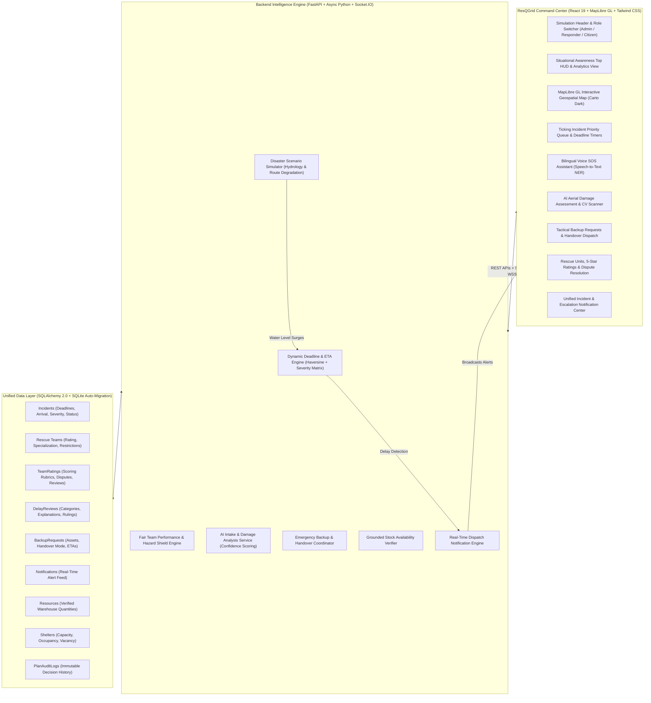

# 🛡️ ResQGrid — AI-Powered Disaster Intelligence & Response Platform

> ### *“Predict Early. Respond Faster. Save Lives.”*
>
> A mission-critical, AI-driven disaster response command and intelligence platform. ResQGrid equips civil defense authorities, incident commanders, emergency response units, and public citizens with real-time situational awareness, predictive hydrological modeling, drone aerial damage assessment, time-bound rescue deadlines, and automated resource coordination.

---

## 🌟 Executive Summary & Core Capabilities

During catastrophic events (flash floods, severe cyclonic storms, urban inundation, bridge washouts, and building collapses), seconds determine survival. **ResQGrid** bridges the gap between field chaos and strategic command through eight core pillars:

1. **Integrated Command Center & Real-Time Situational Awareness:**
   - Multi-metric operations HUD displaying active emergencies, critical severity ratios, ready rescue units, real-time flood gauges, and population impact counters.
   - Live MapLibre GL geospatial map rendering dynamically degraded evacuation routes, shelter capacities, sensor telemetry, and incident markers.

2. **AI Drone Damage Assessment & Computer Vision Scanner:**
   - Evaluates aerial and structural imagery with confidence scores (0.0 to 1.0) and structural integrity percentages.
   - Detects compound hazards (submerged debris, live electrical wiring, toxic runoff, structural fracturing) and pre-fills actionable emergency incidents with 1-click dispatch.

3. **Time-Bound Rescue Deadlines & Ticking Priority Queue:**
   - Dynamically calculates response deadlines based on incident severity (Critical: 25–45m, High: 60–90m) and real-time transit distance.
   - Strictly separates **Arrival On Scene** from **Resolution Complete**, preventing false completion claims.
   - Supervised deadline extensions with mandatory justification logging into an immutable audit trail.

4. **Objective 5-Star Team Performance & Hazard Shields:**
   - Evaluates field units on arrival punctuality, rescue effectiveness, victim safety, and equipment utilization.
   - **Disaster Hazard Protection:** Automatically waives delay penalties when roads are flooded or blocked, protecting responders from unfair performance scoring.
   - Integrated dispute filing and supervisory rating reviews.

5. **Operational Accountability & Delay Review:**
   - Automatically flags overdue responses and prompts responders for structured operational justifications (*Road Inundated, Route Blocked, Extreme Weather, Equipment Failure*).
   - Supervisors issue calibrated rulings: *Justified Exception*, *Formal Advisory*, *Refresher Training*, or *Temporary Operational Restriction*.

6. **Emergency Backup & Mission Handover:**
   - Tactical field escalation enabling units to request specialized reinforcements (Ambulances, Rescue Boats, Helicopters, HAZMAT, Comms, Heavy Rescue).
   - Supports both **Partial Assistance** (multi-unit joint taskforce) and **Complete Mission Handover** (primary unit relieved).

7. **Bilingual Voice SOS Emergency Assistant (Citizen Portal):**
   - Natural-language speech intake powered by the Web Speech API supporting **English** and **Hindi (हिंदी)**.
   - Named Entity Recognition (NER) extracts disaster type, landmark coordinates, casualty count, injuries, and required assets.
   - Issues persistent reference tracking codes (e.g., `RESQ-2026-XXXX`) allowing citizens to monitor rescue progress live.

8. **Grounded Resource Inventory Verification:**
   - Recommends tactical equipment tailored to incident parameters and verifies live warehouse quantities before dispatch, guaranteeing that phantom supplies are never ordered.

---

## 🏛️ System Architecture



---

## 🎯 3 Dedicated Role-Based Dashboards

ResQGrid provides three completely isolated, role-tailored dashboards accessible instantly via the top navigation role switcher:

### 1. 🛡️ Administrator Strategic Command Center (`Admin Mode`)
* **Strategic Operations Map:** Multi-layer MapLibre GL geospatial map rendering all incidents, rated rescue teams, accessible evacuation shelters, and live hydrology sensors.
* **Incident Priority Queue:** Real-time triage with dynamic deadline countdown timers, auto-assign algorithms, and manual supervisory overrides.
* **Situational Intelligence & Analytics:** Live KPI summary cards, river height telemetry gauges, disaster category distribution charts, and decision audit logs.
* **AI Drone Damage Assessment Scanner:** Aerial imagery computer vision analysis with confidence metrics and 1-click incident dispatch.
* **Logistics & Resource Coordination:** Real-time shelter bed capacity tracking and warehouse supply allocation.

### 2. 🚒 Tactical Field Responder Terminal (`Responder Mode`)
* **Unit Identity & Profile:** Active team selector with live 5-star performance rating, on-time response rate, completed missions count, and restriction status.
* **Active Mission Focus:** Highlights the assigned emergency with ticking response deadlines, victim count, and severity indicators.
* **Field Action Controls:**
  - 📌 **"Mark Arrived On Scene"**: Verifies arrival timestamp against deadline and locks punctuality.
  - ⏱️ **"Report / Explain Delay"**: Submits operational delay explanations to activate approved disaster hazard shields.
  - 🚁 **"Request Tactical Backup"**: Requests helicopters, rescue boats, ambulances, comms, or mission handover.
  - ✅ **"Complete & Resolve Rescue"**: Records victim safety status and receives automated 5-star performance rating.
* **Tactical Mission Map:** Route navigation showing clear corridors in teal vs. flooded/blocked roads in red dashed lines, along with nearest accessible hospitals and shelters for casualty drop-off.

### 3. 🆘 Citizen Emergency Lifeline Portal (`Citizen Mode`)
* **Emergency Lifeline Console:** High-visibility hotlines (National 112, Ambulance 108, Municipal Disaster Cell).
* **3 Fast Lifesaving Actions:**
  - 🎙️ **"Bilingual Voice SOS Assistant"**: Speech-to-text reporting in Hindi and English with automatic landmark and casualty extraction.
  - 🚨 **"1-Tap Emergency Panic SOS"**: Instantly transmits device GPS coordinates to Central Dispatch with zero typing.
  - 📝 **"Detailed Incident Report"**: Web form submission for structured reports.
* **Live Emergency Ticket Tracker:** Citizens enter their reference code (`RESQ-XXXX`) to track live dispatch status, assigned rescue team name, and estimated arrival time (ETA).
* **Public Hazard & Safety Bulletin:** Real-time river height levels, city roadway status (safe vs. blocked roads), and walk-in public shelters with bed vacancy counts and food rations.

---

## 📦 Core Modules & Feature Matrix

| Module | Backend Endpoint(s) | Frontend Component | Architectural Guarantee |
| :--- | :--- | :--- | :--- |
| **Command Center & Situational Analytics** | `GET /api/incidents/`<br>`GET /api/simulation/status`<br>`GET /api/sensors/` | [`AnalyticsView.tsx`](file:///Users/vanshkumar/Downloads/H2/frontend/src/components/views/AnalyticsView.tsx)<br>[`Dashboard.tsx`](file:///Users/vanshkumar/Downloads/H2/frontend/src/pages/Dashboard.tsx) | Live situational KPI cards (Active, Critical, Ready Units, Resolution Rate), Hydrology gauge, and Decision Audit Trail feed. Zero hardcoded mock numbers. |
| **AI Damage Scanner & CV Analysis** | `POST /api/ai-assistant/analyze-damage` | [`AIDamageAssessmentModal.tsx`](file:///Users/vanshkumar/Downloads/H2/frontend/src/components/AIDamageAssessmentModal.tsx) | Analyzes aerial drone imagery presets or uploaded captures. Produces structural integrity %, compound hazards, confidence score, and 1-click incident pre-fill. |
| **Time-Bound Rescue Deadlines** | `POST /api/incidents/{id}/mark-arrival`<br>`POST /api/incidents/{id}/resolve`<br>`POST /api/incidents/{id}/adjust-deadline` | [`DeadlineCountdown.tsx`](file:///Users/vanshkumar/Downloads/H2/frontend/src/components/DeadlineCountdown.tsx)<br>[`DeadlineAdjustModal.tsx`](file:///Users/vanshkumar/Downloads/H2/frontend/src/components/DeadlineAdjustModal.tsx) | Deadlines: Critical=25-45m, High=60-90m, Medium=120m + transit buffer. Separate arrival vs. resolution events. Changes logged to immutable audit trail. |
| **5-Star Team Rating & Hazard Shield** | `GET /api/teams/{id}/ratings`<br>`POST /api/teams/ratings/{id}/dispute`<br>`POST /api/teams/ratings/{id}/review` | [`TeamsView.tsx`](file:///Users/vanshkumar/Downloads/H2/frontend/src/components/views/TeamsView.tsx) | Multi-factor rating (punctuality, mission success, victim safety). Automatically waives delay penalties if route or weather hazard is verified. |
| **Delay Review & Accountability** | `POST /api/incidents/{id}/explain-delay`<br>`POST /api/incidents/{id}/review-delay`<br>`POST /api/teams/{id}/restriction` | [`DelayReviewModal.tsx`](file:///Users/vanshkumar/Downloads/H2/frontend/src/components/DelayReviewModal.tsx) | Structured responder explanations and supervisor rulings (*Justified Exception*, *Formal Warning*, *Training*, *Temporary Assignment Restriction*). |
| **Tactical Backup & Mission Handover** | `POST /api/backup-requests/`<br>`POST /api/backup-requests/{id}/assign`<br>`POST /api/backup-requests/{id}/status` | [`BackupRequestModal.tsx`](file:///Users/vanshkumar/Downloads/H2/frontend/src/components/BackupRequestModal.tsx)<br>[`BackupRequestsView.tsx`](file:///Users/vanshkumar/Downloads/H2/frontend/src/components/views/BackupRequestsView.tsx) | Dispatches helicopters, boats, ambulances, comms, or personnel. Supports Partial Assistance and Complete Handover modes. |
| **Bilingual Voice SOS Assistant** | `POST /api/ai-assistant/chat`<br>`POST /api/ai-assistant/submit-voice-report`<br>`GET /api/ai-assistant/status/{ref}` | [`AIAssistantModal.tsx`](file:///Users/vanshkumar/Downloads/H2/frontend/src/components/AIAssistantModal.tsx) | Web Speech API speech-to-text in English and Hindi. NLP entity extraction, missing information prompts, life-saving advice, and live status lookup by code. |
| **Grounded Inventory Dispatch** | `GET /api/incidents/{id}/recommendations` | [`ResourceRecommendationModal.tsx`](file:///Users/vanshkumar/Downloads/H2/frontend/src/components/ResourceRecommendationModal.tsx) | Verifies real available stock from the database before recommending or allocating equipment. |
| **Unified Notification Drawer** | `GET /api/notifications/`<br>`POST /api/notifications/{id}/read` | [`NotificationDrawer.tsx`](file:///Users/vanshkumar/Downloads/H2/frontend/src/components/NotificationDrawer.tsx) | Central real-time alert feed for critical incidents, approaching deadlines, backup requests, and operational status changes. |

---

## 🚀 Quickstart & Startup Instructions

### Prerequisites
* **Python 3.9+** (Virtual environment configured at `.venv`)
* **Node.js 18+** & **npm**

### Step 1: Start the Backend Server (Port 8000)
```bash
# Navigate to the project root
cd /Users/vanshkumar/Downloads/H2

# Activate virtual environment
source .venv/bin/activate

# (Optional) Seed clean database records
PYTHONPATH=. python backend/seed.py

# Start Uvicorn ASGI server with hot-reload
PYTHONPATH=. uvicorn backend.main:app --host 0.0.0.0 --port 8000 --reload
```
* **Interactive API Documentation:** [http://localhost:8000/docs](http://localhost:8000/docs)
* **Backend Health Check:** [http://localhost:8000/health](http://localhost:8000/health)

### Step 2: Start the Frontend Application (Port 5173 / 5174)
```bash
# In a separate terminal window:
cd /Users/vanshkumar/Downloads/H2/frontend

# Launch Vite development server
npm run dev
```
* **Landing Page:** [http://localhost:5173/](http://localhost:5173/)
* **Operations Command Dashboard:** [http://localhost:5173/dashboard](http://localhost:5173/dashboard)

---

## 🧪 Automated Test Suite

ResQGrid maintains a rigorous test suite of **34 automated integration tests** covering all domain services, REST routes, WebSocket broadcasts, deadline algorithms, rating protections, and AI damage assessment:

```bash
cd /Users/vanshkumar/Downloads/H2
source .venv/bin/activate
PYTHONPATH=. pytest backend/tests -v
```

### Test Suite Summary:
* `backend/tests/test_adracs_features.py` (11 tests):
  - Dynamic deadline calculation (Critical severity vs. transit buffer).
  - Arrival tracking (`/mark-arrival`) and resolution (`/resolve`) independence.
  - 5-star performance rating calculation and hazard exception shield.
  - Delay notification, responder explanation, and supervisor corrective actions.
  - Backup request creation, multi-resource selection, and coordinator dispatch.
  - Grounded resource recommendations checking live inventory stock.
  - AI Voice Assistant bilingual NLP entity extraction (Hindi & English).
  - Web Speech voice report direct submission and status retrieval.
  - Team assignment prevention for restricted units.
  - Deadline adjustment with mandatory justification audit log.
  - **AI Damage Assessment Scanner** (confidence score, structural integrity %, and detected hazards).
* `backend/tests/test_api_integration.py` (7 tests): REST & WebSocket endpoints.
* `backend/tests/test_scenarios_a_to_g.py` (7 tests): Complex multi-step field emergency scenarios.
* `backend/tests/test_domain_services.py` (4 tests): Core scoring and triage logic.
* `backend/tests/test_routing_and_replanning.py` (3 tests): Road-closure avoidance and OSRM rerouting.
* `backend/tests/test_simulator.py` (1 test): Flood simulation lifecycle.
* `backend/tests/test_db_and_models.py` (1 test): Database model integrity.

**Result: 34 passed (100% passing)**

---

## ⚙️ Environment Variables & Configuration

The application is engineered to work out-of-the-box with sensible defaults, while allowing external services to be integrated when credentials are provided:

| Variable | Default Value | Description |
| :--- | :--- | :--- |
| `DATABASE_URL` | `sqlite:///./disaster_coord.db` | Database connection string. Automatically defaults to local SQLite with schema auto-migration. |
| `PORT` | `8000` | Port for the FastAPI backend server. |
| `VITE_API_URL` | `http://localhost:8000` | Frontend backend API URL. |
| `GROQ_API_KEY` | *(Optional)* | Optional LLM API key for extended multi-agent reasoning. Falls back automatically to rule-based NDMA intelligence when absent. |
| `GEMINI_API_KEY` | *(Optional)* | Optional Google Gemini key for multimodal image analysis. Falls back to local damage assessment engine when absent. |

---

## 🔒 Security & Data Integrity Guarantees

1. **Clear Simulation Labeling:** All simulated telemetry and scenario metrics are explicitly labeled with `SIMULATED DATA` badges.
2. **Immutable Audit Logging:** Every supervisory action (deadline extension, delay review ruling, backup dispatch) is committed to `PlanAuditLog`.
3. **Restricted Unit Isolation:** Responders with temporary assignment restrictions cannot be assigned to new emergencies.
4. **Speech Data Privacy:** Raw voice audio is processed client-side via the browser Web Speech API; only the extracted textual transcript is transmitted to the server.
5. **Zero Secret Leaks:** No private keys or secrets are committed or exposed in frontend bundles.

---

## 🛡️ License & Academic Context

* **Product:** ResQGrid — AI-Powered Disaster Intelligence & Response Platform
* **Tagline:** “Predict Early. Respond Faster. Save Lives.”
* **Stack:** Python 3.9+, FastAPI, SQLAlchemy 2.0, SQLite, Socket.IO, React 19, TypeScript, Vite, Tailwind CSS v4, MapLibre GL.
