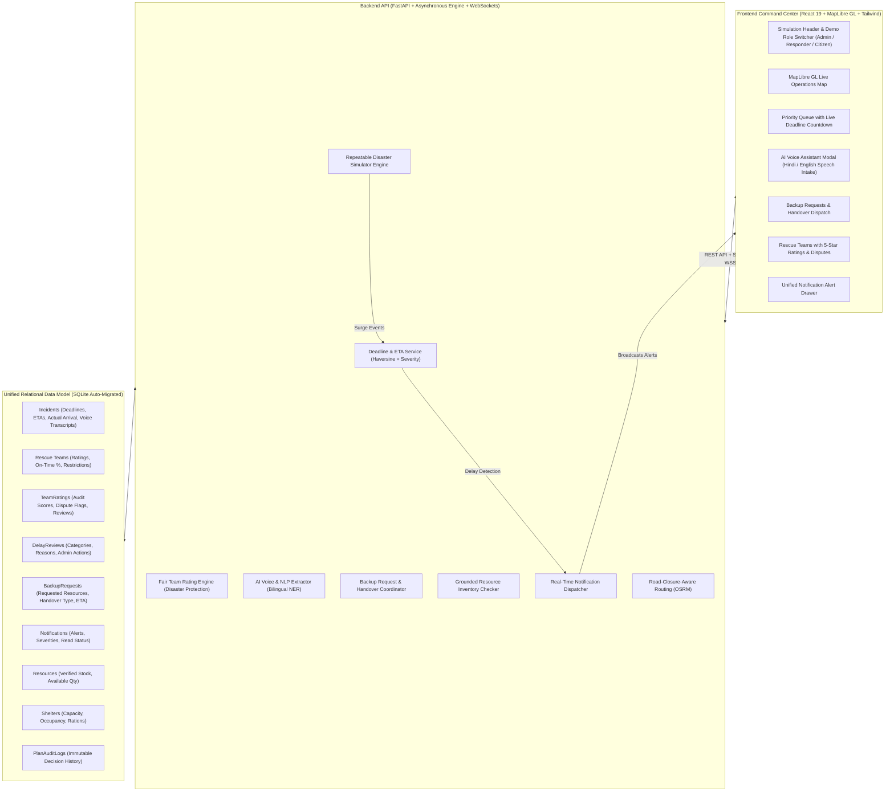

# 🚨 Dynamic Emergency Resource Coordination Command Center (ADRACS)

> **Autonomous Disaster Response and Coordination System (ADRACS)**  
> An upgraded, full-stack disaster-response coordination platform featuring **time-bound rescue deadlines**, **fair team performance evaluation**, **emergency backup & handover**, and **AI voice-driven incident intake**.

---

## 🌟 Executive Summary & Key Upgrades

During critical emergencies such as flash floods and structural collapses, rescue operations require strict coordination, fair team accountability, and rapid citizen access:
* **Time-Bound Rescue Deadlines:** Dynamic response deadlines computed automatically from incident severity and transit distance.
* **Separation of Arrival vs. Resolution:** Estimated arrival time (ETA) is never treated as proof of victim rescue; arrival and resolution are tracked independently.
* **Fair 5-Star Team Performance Rating:** Objective rating based on on-time arrival %, mission success, and victim safety, with **mandatory protections** against penalties when disasters render roads impassable.
* **Delay Consequences & Supervisor Review:** Automated delay detection, responder explanation logging, and administrative accountability (Warning, Training, Temporary Assignment Restriction).
* **Emergency Backup & Handover:** Field teams can request tactical backup (Helicopter, Rescue Boat, Ambulance, Fire Brigade, Comms, Personnel) with central coordinator dispatch and partial/complete handover modes.
* **AI Emergency Assistant with Voice Reporting (Meesho-Style):** Bilingual (English & Hindi) voice and text conversational intake powered by Web Speech API with NLP entity extraction, missing information prompts, life-saving safety guidance, and status tracking by reference ID.
* **Grounded Resource Recommendations:** Automatic equipment recommendations verified against live database inventory before dispatch.
* **Unified Notification Center:** Real-time alert notifications for critical incidents, approaching/missed deadlines, backup requests, and status changes.
* **Demo Role Switcher:** Instant perspective switching between **Administrator / Control Room**, **Field Responder Team**, and **Citizen / Public** for seamless classroom presentation to instructors.

---

## 🏛️ System Architecture



---

## 📦 Upgraded Features & Implementation Map

| Feature Module | Backend Service & Endpoints | Frontend Component(s) | Key Guarantee & Logic |
| :--- | :--- | :--- | :--- |
| **1. Emergency Rescue Deadline & Tracking** | [`backend/services/deadline_service.py`](file:///Users/vanshkumar/Downloads/H2/backend/services/deadline_service.py)<br>`POST /api/incidents/{id}/mark-arrival`<br>`POST /api/incidents/{id}/resolve`<br>`POST /api/incidents/{id}/adjust-deadline` | [`frontend/src/components/DeadlineCountdown.tsx`](file:///Users/vanshkumar/Downloads/H2/frontend/src/components/DeadlineCountdown.tsx)<br>[`frontend/src/components/DeadlineAdjustModal.tsx`](file:///Users/vanshkumar/Downloads/H2/frontend/src/components/DeadlineAdjustModal.tsx) | Deadlines: Critical=25-45m, High=60-90m, Medium=120m, Low=240m + transit time. Live ticking countdown with amber/red alerts. Separate arrival and resolution tracking. Admin adjustments log mandatory reasons. |
| **2. Rescue Team Performance Rating** | [`backend/services/rating_service.py`](file:///Users/vanshkumar/Downloads/H2/backend/services/rating_service.py)<br>`GET /api/teams/{id}/ratings`<br>`POST /api/teams/ratings/{id}/dispute`<br>`POST /api/teams/ratings/{id}/review` | [`frontend/src/components/views/TeamsView.tsx`](file:///Users/vanshkumar/Downloads/H2/frontend/src/components/views/TeamsView.tsx) | 5-star scoring formula. Teams cannot self-edit. Approved disaster exceptions (flooded bridges, roadblocks) are completely shielded from delay penalties. Supervisors can adjust disputed ratings. |
| **3. Delay Consequences & Accountability** | [`backend/api/incidents.py`](file:///Users/vanshkumar/Downloads/H2/backend/api/incidents.py)<br>`POST /api/incidents/{id}/explain-delay`<br>`POST /api/incidents/{id}/review-delay`<br>`POST /api/teams/{id}/restriction` | [`frontend/src/components/DelayReviewModal.tsx`](file:///Users/vanshkumar/Downloads/H2/frontend/src/components/DelayReviewModal.tsx) | Missed deadlines automatically notify admin. Team provides operational explanation (Road Blocked, Severe Weather, etc.). Admin reviews and issues corrective actions: Warning, Review, Training, or Temporary Assignment Restriction. |
| **4. Emergency Assistance & Team Handover** | [`backend/api/backup_requests.py`](file:///Users/vanshkumar/Downloads/H2/backend/api/backup_requests.py)<br>`POST /api/backup-requests/`<br>`POST /api/backup-requests/{id}/assign`<br>`POST /api/backup-requests/{id}/status` | [`frontend/src/components/BackupRequestModal.tsx`](file:///Users/vanshkumar/Downloads/H2/frontend/src/components/BackupRequestModal.tsx)<br>[`frontend/src/components/views/BackupRequestsView.tsx`](file:///Users/vanshkumar/Downloads/H2/frontend/src/components/views/BackupRequestsView.tsx) | Assigned team clicks "Request Backup" to request Helicopters, Boats, Ambulances, Comms, or Personnel. Single incident record maintained. Supports Partial Assistance and Complete Handover. Coordinator assigns verified available teams. |
| **5. AI Emergency Assistant with Voice Reporting** | [`backend/services/ai_assistant_service.py`](file:///Users/vanshkumar/Downloads/H2/backend/services/ai_assistant_service.py)<br>`POST /api/ai-assistant/chat`<br>`POST /api/ai-assistant/submit-voice-report`<br>`GET /api/ai-assistant/status/{ref}` | [`frontend/src/components/AIAssistantModal.tsx`](file:///Users/vanshkumar/Downloads/H2/frontend/src/components/AIAssistantModal.tsx) | Meesho-style voice & text chatbot. Web Speech API with Hindi & English support. Extracts emergency type, location, affected count, injuries, and needed resources. Directly creates incident in backend and returns reference code. Checks live status. |
| **6. Grounded Resource Recommendations** | [`backend/services/recommendation_service.py`](file:///Users/vanshkumar/Downloads/H2/backend/services/recommendation_service.py)<br>`GET /api/incidents/{id}/recommendations` | [`frontend/src/components/ResourceRecommendationModal.tsx`](file:///Users/vanshkumar/Downloads/H2/frontend/src/components/ResourceRecommendationModal.tsx) | Automatically matches incident characteristics to supplies. Checks live `available_qty` in the database—never claims assets are available if stock is 0. Coordinator approves allocation. |
| **7. Unified Notifications & Central Dashboard** | [`backend/services/notification_service.py`](file:///Users/vanshkumar/Downloads/H2/backend/services/notification_service.py)<br>`GET /api/notifications/`<br>`POST /api/notifications/{id}/read` | [`frontend/src/components/NotificationDrawer.tsx`](file:///Users/vanshkumar/Downloads/H2/frontend/src/components/NotificationDrawer.tsx) | Unified alert center for critical incidents, upcoming/missed deadlines, backup requests, team assignments, and status updates. Unread badge with slide-out drawer. |
| **8. Database Auto-Migration & Integrity** | [`backend/database/models.py`](file:///Users/vanshkumar/Downloads/H2/backend/database/models.py)<br>[`backend/database/db.py`](file:///Users/vanshkumar/Downloads/H2/backend/database/db.py) | Full schema preservation | SQLite auto-migration using `PRAGMA table_info` and `ALTER TABLE ... ADD COLUMN` ensures existing database files seamlessly upgrade without data loss. |

---

## 🚀 Quickstart & Setup Instructions

### Prerequisites
* **Python 3.9+** (Virtual environment included at `.venv`)
* **Node.js 18+** & **npm**

### Step 1: Start the Backend Server
```bash
# 1. Open terminal and navigate to project root
cd /Users/vanshkumar/Downloads/H2

# 2. Activate virtual environment
source .venv/bin/activate

# 3. (Optional) Re-seed fresh demo data
PYTHONPATH=. python backend/seed.py

# 4. Start the FastAPI backend server with WebSockets (port 8000)
PYTHONPATH=. uvicorn backend.main:app --host 0.0.0.0 --port 8000 --reload
```
* **Swagger API Docs:** [http://localhost:8000/docs](http://localhost:8000/docs)  
* **Health Check:** [http://localhost:8000/health](http://localhost:8000/health)

### Step 2: Start the Frontend Application
```bash
# In a new terminal window:
cd /Users/vanshkumar/Downloads/H2/frontend

# Start the Vite development server (port 5173)
npm run dev
```
* **Application URL:** [http://localhost:5173](http://localhost:5173)

---

## 🧪 Automated Test Suite

The test suite validates every module with **33 automated tests**:
* `backend/tests/test_adracs_features.py` (10 tests):
  - Dynamic deadline calculation (Critical severity vs transit distance).
  - Arrival tracking (`/mark-arrival`) and resolution (`/resolve`) separation.
  - 5-star performance rating calculation and disaster hazard exceptions.
  - Delay notification, team explanation, and supervisor corrective actions.
  - Backup request creation, multi-resource selection, and coordinator assignment.
  - Grounded resource recommendations checking live inventory stock.
  - AI Assistant bilingual NLP entity extraction (Hindi & English).
  - Web Speech voice report direct submission and status retrieval.
  - Team assignment prevention for restricted teams.
  - Deadline adjustment with mandatory justification audit log.
* `backend/tests/test_api_integration.py` (7 tests): REST & WebSocket endpoints.
* `backend/tests/test_scenarios_a_to_g.py` (7 tests): Complex multi-step field scenarios.
* `backend/tests/test_domain_services.py` (4 tests): Core scoring and triage logic.
* `backend/tests/test_routing_and_replanning.py` (3 tests): Road-closure avoidance and OSRM rerouting.
* `backend/tests/test_simulator.py` (1 test): Flood simulation lifecycle.
* `backend/tests/test_db_and_models.py` (1 test): Database model integrity.

### Running the Test Suite
```bash
cd /Users/vanshkumar/Downloads/H2
source .venv/bin/activate
PYTHONPATH=. pytest backend/tests -v
```
*Expected Result:* **33 passed (100%)**

---

## 🎓 Teacher & Demonstration Guide

Follow this guide to demonstrate all features to your teacher:

### Step 1: Demonstrate the Demo Role Switcher
* Look at the top navigation bar. Notice the **Demo Role** toggle:
  - **Admin / Control Room:** Full supervisory authority to adjust deadlines, review delays, and assign backups.
  - **Rescue Team Responder:** Field perspective showing assigned incidents, "Request Backup", and arrival reporting.
  - **Public Citizen:** Highlights the **AI Voice Assistant** with a prominent citizen emergency banner.

### Step 2: Demonstrate the AI Emergency Assistant with Voice Reporting
* Click the glowing **"Voice SOS"** or **"AI Voice Assistant"** button.
* Select language (**English** or **हिंदी**).
* Click the microphone button and speak (or click one of the pre-loaded **Voice Demo** quick-speech buttons, e.g. Hindi: *"Main flood mein phansa hua hoon. Mere paas teen log hain. Humein medical help chahiye..."*).
* Observe the AI extract:
  - **Emergency Type:** Flood / Inundation
  - **Location:** Pune Riverbank / Low-lying area
  - **People Affected:** 3
  - **Required Resources:** Rescue boat, Medical team
* Click **"Submit Emergency Report to Dispatch"**.
* The system assigns a real incident reference code (e.g., `ADR-2026-XXXX`).
* Switch to the **"Check Incident Status"** tab in the modal and paste the reference code to see live triage status.

### Step 3: Demonstrate Emergency Rescue Deadlines & Live Countdown
* Switch the view to the **Operations Map**.
* In the right-hand **Incident Priority Queue**, inspect the active incident cards:
  - Each card displays a live ticking **DeadlineCountdown**:
    - Normal (Cyan/Green): e.g., `42m 15s remaining`.
    - Warning (Amber): `< 15m remaining`.
    - Delayed (Red flashing): `OVERDUE by 08m 20s`.
  - Notice the separate tracking buttons:
    - **Mark Team Arrived:** Records actual arrival timestamp and checks whether the team arrived on time or late.
    - **Resolve Rescue:** Records rescue completion, victim safety status, and calculates the team's 5-star score.
  - Click **"Adjust Deadline"**: Enter a new time and a mandatory reason (e.g., *"Flash flood washed out river access road"*). Show the audit confirmation.

### Step 4: Demonstrate Delay Consequences & Fair Accountability
* On a delayed incident, click **"Report/Review Delay"**:
  - As a **Responder**, select delay category (e.g., *Road Blocked*, *Severe Weather*, *Equipment Failure*) and submit an operational explanation.
  - Switch role to **Admin**: Review the explanation and select a corrective action (e.g., *Justified Hazard Exception*, *Formal Warning*, *Additional Training*, or *Temporary Assignment Restriction*).
  - Emphasize to the teacher: **Genuine disaster hazards are marked as approved exceptions and do not penalize responders unfairly.**

### Step 5: Demonstrate Rescue Team Performance Ratings
* Click the **"Rescue Teams & Ratings"** tab in the left sidebar.
* View the performance cards for each team:
  - **Average Rating (out of 5.0 ★)**
  - **Completed Rescues**
  - **On-Time Response Rate %**
  - **Delayed Rescues Count**
* Click **"View Rating Breakdown & History"** to show individual past mission ratings.
* Show the **"Dispute Rating"** feature where teams can request supervisory review if an unfair penalty was applied due to disaster conditions.

### Step 6: Demonstrate Emergency Backup & Handover
* On the Teams view or on an assigned incident card, click **"Request Backup"**.
* The modal allows selecting required resources:
  - Helicopter
  - Rescue Boat
  - Ambulance
  - Medical Team
  - Fire Brigade
  - Additional Personnel
* Select **Urgency Level** (Critical / High) and choose **Handover Mode** (*Partial Assistance* vs *Complete Mission Handover*).
* Submit the request.
* Switch to the **"Backup & Handover"** tab in the sidebar:
  - View the incoming request in the control room dashboard.
  - Select an available team from the verified list, enter estimated transit time, and click **"Dispatch Backup Team"**.
  - Notice the status update and the requesting team's notification!

### Step 7: Demonstrate Grounded Resource Recommendations
* On any active incident in the priority queue, click the **"Resource Advice"** sparkle icon.
* The modal analyzes the incident (e.g., Flood + Casualties) and recommends appropriate resources (e.g., Rescue Boats, Trauma Packs, Ambulances).
* Point out the **"Stock Confirmed"** check: it directly checks live inventory in the database, ensuring control rooms never dispatch non-existent equipment.

### Step 8: Demonstrate Real-Time Notifications
* Click the **Bell Icon** in the top navigation.
* The slide-out notification drawer displays categorized alerts:
  - Critical Incidents
  - Upcoming & Missed Deadlines
  - Backup Dispatches
  - Team Status Updates
* Click **"Mark All Read"** or dismiss individual alerts.

---

## 🔒 Security, Safety Guarantees & Constraints

1. **Simulated Data Integrity:** All mock data is clearly badged with a glowing `"SIMULATED DATA"` indicator in the header.
2. **Immutable Audit Trail:** All administrative decisions (deadline extensions, delay reviews, backup assignments) are permanently logged in the `PlanAuditLog` table.
3. **Restricted Team Protection:** Teams placed under temporary restriction cannot be auto-assigned to new incidents until cleared by a supervisor.
4. **Speech Privacy:** Raw audio is processed locally via browser Web Speech API; only finalized text transcripts are transmitted to the backend.
5. **No Hardcoded Secrets:** All configurations use environment variables with fallback defaults.

---

## 👥 Contributors & Academic Context

* **Project:** Autonomous Disaster Response and Coordination System (ADRACS)
* **Stack:** Python 3.9+, FastAPI, SQLAlchemy 2.0, SQLite, Socket.IO, React 19, Vite, Tailwind CSS, MapLibre GL.
