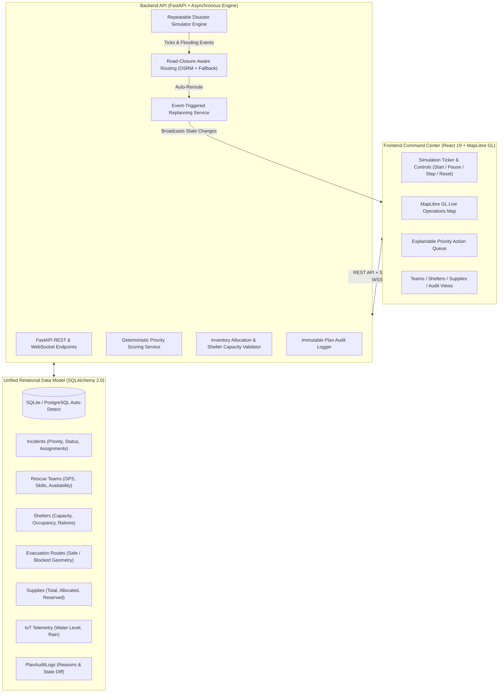

# 🚨 Dynamic Emergency Resource Coordination Command Center

> **An Autonomous Disaster Response, Dynamic Simulation, and Resource Coordination Platform**  
> Built for the Student Hackathon: *Dynamic Emergency Resource Coordination*  
> Merged & Engineered from **ADRACS** and **ResQNet** with zero modification to upstream source repositories.

---

## 🌟 Executive Summary

During critical disasters such as floods, conditions on the ground degrade continuously:
* Incoming citizen SOS and sensor telemetry spike simultaneously.
* River levels rise and submerge bridges, severing key evacuation corridors.
* Emergency relief shelters approach maximum capacity and run low on rations.
* Field rescue teams and physical supplies (boats, food, trauma kits) are limited and must be allocated to competing needs.

This platform provides a **unified, resilient command center** powered by:
1. **Deterministic Safety Validation:** Hard mathematical constraints on shelter capacity, inventory allocation, and skill matching that cannot be bypassed.
2. **Explainable Priority Scoring:** Transparent multi-factor triage calculating dynamic priority scores ($0.0 - 100.0$) with exact factor breakdowns.
3. **Road-Closure-Aware Routing & Event Replanning:** Invalidation of flooded transit routes and automatic detour calculation via OSRM.
4. **Repeatable Disaster Simulator:** Complete scenario control with `start`, `pause`, `step`, and `reset` to baseline.
5. **NASA-Grade Interactive Command Center:** React 19, MapLibre GL vector maps, live WebSockets, and clear simulated data labeling.

---

## 🏛️ System Architecture



---

## 📦 Required Modules & Implementation Map

Every module mandated by the project requirements is implemented with exact file references:

| Required Module | Implementation File(s) | Description & Safety Guarantee |
| :--- | :--- | :--- |
| **1. Incident Intake & Validation** | [`backend/api/incidents.py`](file:///Users/vanshkumar/Downloads/H2/backend/api/incidents.py)<br>[`backend/schemas.py`](file:///Users/vanshkumar/Downloads/H2/backend/schemas.py) | Strict Pydantic v2 schemas validating coordinates, severity, required skills, and supply needs. |
| **2. Explainable Incident Priority Scoring** | [`backend/services/priority_service.py`](file:///Users/vanshkumar/Downloads/H2/backend/services/priority_service.py) | Transparent scoring: Severity (max 40) + Hazard (max 25) + Environment (max 15) + Vulnerability (max 10) + Wait Time (max 10). Emits full JSON explanation. |
| **3. Shared Resource Inventory & Reservation** | [`backend/services/resource_service.py`](file:///Users/vanshkumar/Downloads/H2/backend/services/resource_service.py)<br>[`backend/api/resources.py`](file:///Users/vanshkumar/Downloads/H2/backend/api/resources.py) | Deterministic stock validation: rejects requests exceeding available stock (`qty <= available_qty`). Supports two-phase reservation & release. |
| **4. Team Assignment with Skill & Proximity** | [`backend/services/team_service.py`](file:///Users/vanshkumar/Downloads/H2/backend/services/team_service.py)<br>[`backend/api/teams.py`](file:///Users/vanshkumar/Downloads/H2/backend/api/teams.py) | Enforces team availability (`Available`/`Returning`), skill compatibility (`Flood Rescue`, `Medical`, `Hazmat`), and Haversine proximity. |
| **5. Shelter Capacity & Accessibility Checks** | [`backend/services/shelter_service.py`](file:///Users/vanshkumar/Downloads/H2/backend/services/shelter_service.py)<br>[`backend/api/shelters.py`](file:///Users/vanshkumar/Downloads/H2/backend/api/shelters.py) | Hard capacity check (`occupancy + evacuees <= capacity`) and road accessibility verification. Rejects overcapacity with clear error audit. |
| **6. Road-Closure-Aware Route Planning** | [`backend/services/routing_service.py`](file:///Users/vanshkumar/Downloads/H2/backend/services/routing_service.py)<br>[`backend/api/routes_evac.py`](file:///Users/vanshkumar/Downloads/H2/backend/api/routes_evac.py) | Checks database for blocked corridors. Computes safe routes via OSRM or perimeter waypoint detours. Returns GeoJSON coordinates. |
| **7. Event-Triggered Replanning** | [`backend/services/replanning_service.py`](file:///Users/vanshkumar/Downloads/H2/backend/services/replanning_service.py) | Triggered when roads flood or shelters saturate: automatically recalculates detour paths and diverts evacuees to alternative shelters. |
| **8. Repeatable Flood/Disaster Simulator** | [`backend/services/simulation_engine.py`](file:///Users/vanshkumar/Downloads/H2/backend/services/simulation_engine.py)<br>[`backend/api/simulation.py`](file:///Users/vanshkumar/Downloads/H2/backend/api/simulation.py) | Complete state machine with `start`, `pause`, `step`, and `reset` controls. Deterministically steps rainfall, river levels, and shelter drain. |
| **9. Audit / Event History** | [`backend/services/audit_service.py`](file:///Users/vanshkumar/Downloads/H2/backend/services/audit_service.py)<br>[`backend/api/audit_logs.py`](file:///Users/vanshkumar/Downloads/H2/backend/api/audit_logs.py) | Immutable `PlanAuditLog` table recording timestamps, entity IDs, actions, and exact reasons explaining why decisions or reroutes occurred. |
| **10. Clear Hackathon UI** | [`frontend/src/pages/Dashboard.tsx`](file:///Users/vanshkumar/Downloads/H2/frontend/src/pages/Dashboard.tsx)<br>[`frontend/src/components/`](file:///Users/vanshkumar/Downloads/H2/frontend/src/components/) | Dark-mode command center displaying simulated telemetry clearly labeled. Interactive map, live priority queue, and dedicated views for all entities. |

---

## 🚀 Quickstart & Run Instructions

### Prerequisites
* **Python 3.9+**
* **Node.js 18+** & **npm**

### Step 1: Set Up & Run the Backend
```bash
# 1. Navigate to the project root
cd /Users/vanshkumar/Downloads/H2

# 2. Activate Python virtual environment
source .venv/bin/activate

# 3. (Optional) Inspect environment variables
cp .env.example .env

# 4. Start the FastAPI backend server (Runs on port 8000)
PYTHONPATH=. uvicorn backend.main:app --host 0.0.0.0 --port 8000 --reload
```
*API Documentation & Swagger UI:* [http://localhost:8000/docs](http://localhost:8000/docs)  
*Health Check:* [http://localhost:8000/health](http://localhost:8000/health)

### Step 2: Set Up & Run the Frontend Command Center
Open a second terminal window:
```bash
# 1. Navigate to frontend directory
cd /Users/vanshkumar/Downloads/H2/frontend

# 2. Start the Vite development server (Runs on port 5173)
npm run dev
```
*Open in Browser:* [http://localhost:5173](http://localhost:5173)

---

## 🧪 Automated Test Suite

The test suite validates every module with **16 comprehensive automated tests**:
* `test_db_and_models.py`: Model creation, schema relations, and computed properties.
* `test_domain_services.py`: Explainable priority formulas, inventory allocation/reservation limits, team skill matches, and shelter capacity checks.
* `test_routing_and_replanning.py`: Road-closure avoidance routing, flood trigger event replanning, and shelter overflow diversion.
* `test_simulator.py`: Repeatable step-by-step flood simulation, sensor updates, critical incident generation, and baseline reset.
* `test_api_integration.py`: End-to-end REST and WebSocket API validation via FastAPI `TestClient`.

### Running Tests
```bash
cd /Users/vanshkumar/Downloads/H2
source .venv/bin/activate
PYTHONPATH=. pytest backend/tests/ -v
```
*Expected Result:* **16 passed (100%)**

---

## 🎮 Hackathon Demonstration Walkthrough

When presenting to judges, follow this step-by-step scenario:

1. **Baseline State:**
   - Launch the dashboard at `http://localhost:5173`.
   - Point out the **"SIMULATED DATA"** badge in the header.
   - Note the baseline conditions: River water level at **2.40m** (Normal), all evacuation routes showing **Green (Safe)**, and 1 medium priority river advisory.
2. **Step-by-Step Flood Surge:**
   - Click the **"Step"** button in the header toolbar twice.
   - Watch the water level climb from $2.40\text{m} \rightarrow 2.75\text{m} \rightarrow 3.10\text{m}$.
   - On the 3rd step (water level $\ge 3.40\text{m}$), observe the system **automatically detect a critical flood surge**:
     - A new Critical Incident appears: *"Flash Inundation - Low-Lying Riverfront"*.
     - Its explainable priority score jumps to $\ge 75.0$. Expand the card to show judges the exact mathematical breakdown (Severity, Hazard, Vulnerability, Wait Time).
3. **Team Dispatch:**
   - Click **"Auto-Assign Team"** on the incident card.
   - The system checks available teams, matches the `Flood Rescue` specialization, calculates proximity, dispatches `NDRF Team Alpha`, and marks the incident `In Progress`.
4. **Road Flooding & Dynamic Auto-Reroute:**
   - Step the simulation until water level exceeds **$5.0\text{m}$**.
   - The Mula-Mutha Causeway sensor turns **Critical (Red)**.
   - The route transitions to **Blocked (Dashed Red Line)** on the map.
   - The system executes **Module 7 Event-Triggered Replanning**:
     - Calculates an avoidance perimeter detour via OSRM.
     - Logs the reason in the **Decision Audit Trail**.
5. **Shelter Saturation & Diversion:**
   - Switch to the **"Evac Shelters"** tab.
   - Click *"Admit Evacuees"* to saturate Pune Municipal Shelter.
   - When occupancy reaches 100%, subsequent evacuations are automatically diverted to the secondary sports complex shelter.
6. **Repeatable Reset:**
   - Click the **"Reset"** button in the header.
   - The entire database and simulator cleanly reset to Tick #0 baseline state.

---

## 🔒 Source Code Integrity & Security

* **Upstream Preservation:** Neither [`ResQNet`](file:///Users/vanshkumar/ResQNet) nor [`Autonomous-Disaster-Response-And-Coordination-System`](file:///Users/vanshkumar/Autonomous-Disaster-Response-And-Coordination-System) was modified or overwritten.
* **Credentials:** No secrets, tokens, or private credentials are hardcoded. A template `.env.example` is provided, and local `.db` files and environment configs are gitignored.
